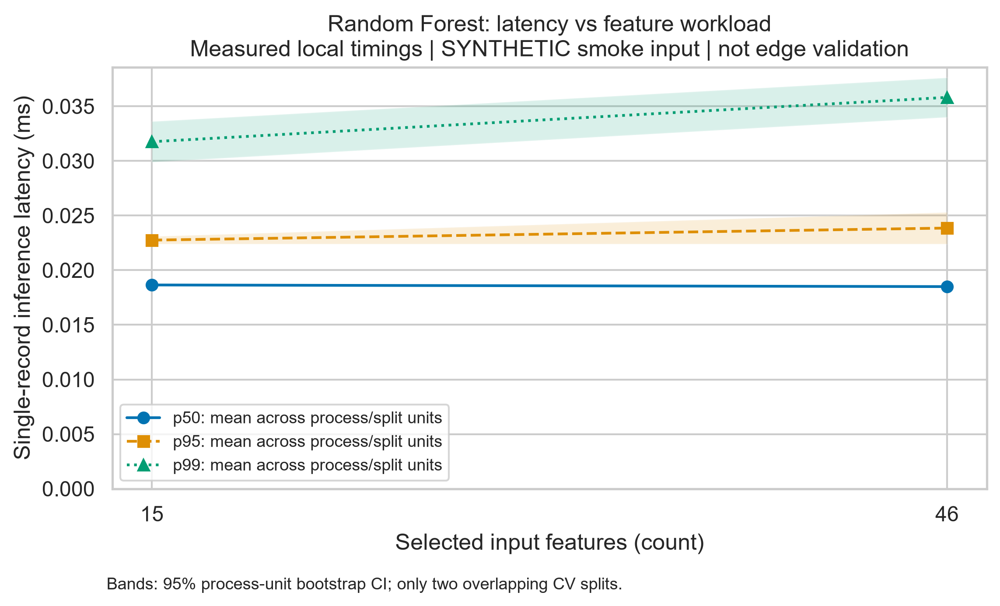
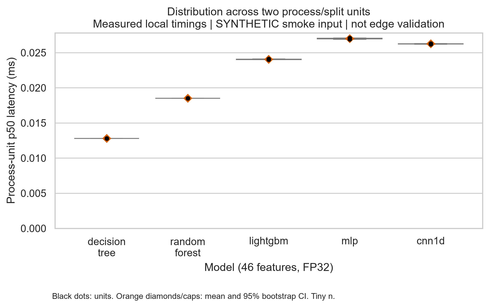

# Lightweight IoT IDS benchmark - Task 3

**Author: Ilkhan Kuanyshev | Status: executed smoke analysis | License: inherited MIT**

> Timings are measured on this local computer. Input data are SYNTHETIC.
> Real CICIoT2023 detection results, target-device results and H1.1-H1.3 conclusions are unavailable.

## Project overview

Study the accuracy-cost trade-off across Decision Tree, Random Forest, LightGBM,
MLP and 1D-CNN, with train-only feature selection and neural INT8 quantization.
The scientific goal is maximum macro-F1 within p50 <= 1 ms and model size <= 1 MiB,
plus RAM, false-positive and stability guardrails. This package continues the
existing Task 2 implementation at revision 51759722daee772e40310fccc0ce72e9b03dea8c.

## Quickstart

Python 3.13 / Windows is the tested Task 3 environment. CPU only; no GPU required.
The test fixture is small. Full dataset training may require substantially more RAM.

```bash
python -m pip install -r requirements-task3-lock.txt
python -m src.task3
python scripts/execute_notebook.py
```

This regenerates analysis from the bundled raw log; it does not generate invented timings.
To recollect actual smoke timings: `python -m src.task3 --collect`.
Tests: `python -m pytest -q`. PDF/Markdown rebuild: `python scripts/build_report.py`.

## Results & Discussion

**Measured local execution / synthetic input. Two process/split units per configuration.**

| Configuration         | p50 ms, mean +/- SD   | 95% CI (ms)        |   Synthetic F1 |   Size (KiB) |
|:----------------------|:----------------------|:-------------------|---------------:|-------------:|
| Baseline RF, 46, FP32 | 0.01850 +/- 0.00000   | [0.01850, 0.01850] |              1 |        133.9 |
| Proposed RF, 15, FP32 | 0.01865 +/- 0.00007   | [0.01860, 0.01870] |              1 |        136.5 |

p50 is mean +/- sample SD across unit p50s; CI is a 4,000-resample whole-unit bootstrap.
With only two overlapping folds, these CIs are descriptive and weak. F1 has no
real-world interpretation. The observed p50 reduction is -0.8%, with no
hypothesis decision or selected deployment winner.

2,800 warm-up records excluded; 28,000 benchmark
calls retained; 0 request errors; 0
configuration failures; 3,380 outliers flagged without deletion.



Feature count is the actual workload factor. No offered RPS was measured.



Dots show process-unit p50s; orange caps show bootstrap CI. Both figures also have vector PDFs.

## Repository structure

- `src/`: original training/ONNX code plus raw logging, processing and visualization.
- `configs/`: full Task 2 design and explicitly synthetic smoke configurations.
- `data/raw/test_run.jsonl`: phase-labelled, actually timed smoke calls.
- `data/raw/provenance.json`: origin, input hashes, environment and configuration.
- `data/processed/`: summaries, quality outputs, error manifest and outlier flags.
- `notebooks/01_data_analysis.ipynb`: executed notebook with visible outputs.
- `docs/domain_model.md`: formal ML model, measurement diagram and STRIDE matrix.
- `reports/`: PDF/Markdown report, figures and validation record.
- `tests/`: inherited tests plus Task 3 integrity/aggregation tests.

## Domain model and reproducibility

[Formal domain model](docs/domain_model.md) | [Reproduction and full-run instructions](docs/reproduction.md)

[PDF report](reports/Task3_Report.pdf) | [Markdown report](reports/Task3_Report.md)

The original requirements.txt/Dockerfile remain for Task 2. The Task 3 lock records
the actual Windows environment and is not a platform-independent Docker lock.
No commit, remote push or release tag has been published by this work.
Do not label task3-smoke-v1 a completed scientific benchmark.

## Citation & license

Original code license is retained in LICENSE; dataset licensing remains with its publisher.

```bibtex
@software{kuanyshev_task3_2026,
  author = {Kuanyshev, Ilkhan},
  title = {Lightweight IoT IDS Benchmark: Task 3 Smoke Analysis},
  year = {2026},
  note = {Measured local smoke timings; synthetic input; unpublished Task 3 package}
}
```
