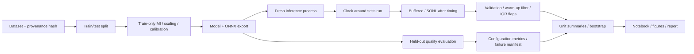

# Domain model: lightweight IoT IDS benchmark

Author: Ilkhan Kuanyshev. Task 3, continuation of Tasks 1 and 2.

## Scope and entities

The research object is an offline, supervised eight-class intrusion detector.
An observation is a feature vector, not a raw packet. Feature extraction, network
queues and packet capture are outside the measured inference boundary.

| Symbol | Meaning | Unit / domain |
|---|---|---|
| $D$ | Dataset of labelled traffic records | $\{(x_i,y_i)\}_{i=1}^N$ |
| $x_i$ | Feature vector before selection | $\mathbb{R}^{46}$ |
| $y_i$ | True traffic category | $\{0,\ldots,7\}$ |
| $C$ | Number of categories | 8 |
| $s$ | Paired train/test split | 0 through 14 in the full design |
| $T_s,E_s$ | Training and evaluation index sets | Disjoint within each split |
| $k$ | Selected features | 46, 30, 15, 10 |
| $S_{s,k}$ | Top-k MI selector fitted only on $T_s$ | Feature indices |
| $m$ | Model family | DT, RF, LightGBM, MLP, 1D-CNN |
| $q$ | Exported weight representation | FP32; INT8 for neural models |
| $\theta$ | Learned parameters | Model dependent |
| $p_{ic}$ | Predicted probability for category c | [0,1] |
| $\hat y_i$ | Predicted category from exported ONNX graph | argmax label |
| $t_j$ | Timed inference call duration | ms / record, batch=1 |
| $Q_p(t)$ | Empirical latency quantile | ms |
| $B$ | Bootstrap resamples | 4000 |
| $M,R$ | ONNX size, peak process working set/RSS | KiB, MiB |
| $b$ | Benign category | Index defined in src/data.py |
| $\epsilon$ | Non-inferiority margin | 0.01 macro-F1 = 1 percentage point |

Classes: Benign, DDoS, DoS, Mirai, Recon, Spoofing, Web and BruteForce.
The upstream mapping rejects unknown attack labels rather than silently relabelling them.

## Loss and prediction

Neural classification uses cross entropy (tree learners retain their own impurity/objective):

$$L(\theta;T_s)=-\frac{1}{|T_s|}\sum_{i\in T_s}\sum_{c=0}^{7}
\mathbf{1}[y_i=c]\log p_\theta(c\mid S_{s,k}(x_i)).$$

$$\hat y_i=\arg\max_c p_\theta(c\mid S_{s,k}(x_i)).$$

Scaling, MI selection and INT8 calibration use training rows only. ONNX outputs,
including INT8 outputs, are evaluated on the held-out rows. Synthetic resampled
rows in the smoke run do not become independent real observations.

## Quality, cost and guardrails

$$F1_c=\frac{2TP_c}{2TP_c+FP_c+FN_c},\qquad
F1_{macro}=\frac{1}{8}\sum_{c=0}^{7}F1_c.$$

Zero-denominator class F1 is defined as zero, with all eight classes retained.

$$Recall_c=\frac{TP_c}{TP_c+FN_c},\qquad
FPR_{benign}=\frac{\sum_{i\in E_s}\mathbf{1}[y_i=b\land\hat y_i\ne b]}
{\sum_{i\in E_s}\mathbf{1}[y_i=b]}.$$

FPR is undefined if no benign observations exist; an undefined guardrail fails closed.

$$t_j=(clock_{after}-clock_{before})/10^6,\quad
Throughput=\frac{batch\_size\times repetitions}{elapsed\_seconds}.$$

Throughput is measured at batch=256; it is not $1000/Q_{50}(t)$ and is not an
offered network request rate. Calls include ONNX Runtime Python invocation and
returned outputs; input preparation, serialization and disk logging are outside
the timed interval. This is not pure hardware kernel time.

$$ErrorRate=\frac{N_{failed\ benchmark\ calls}}{N_{all\ benchmark\ calls}}.$$

Request errors and configuration failures are separate: a killed process may
never emit a request log, so the configuration manifest must also be inspected.

$$c^*=\arg\max_c F1_{macro}(c)\quad\text{subject to}\quad
Q_{50}(t_c)\le1\;ms,\ M_c\le1024\;KiB,\ R_c\le512\;MiB,
\ FPR_c\le0.02,\ failures_c=0.$$

All required splits and metrics must be present. A missing value is not a pass.
Configuration a dominates b when F1(a) >= F1(b), latency(a) <= latency(b), and
at least one inequality is strict. No deployment optimum is selected from smoke data.

## Uncertainty model

For each configuration, first compute a percentile $u_s=Q_p(t_s)$ within each
process/split unit. Report $\bar u=\sum_s u_s/n$. Resample n whole unit values
with replacement B times and take the 2.5th/97.5th percentiles of the bootstrap means.
The SD in the summary is the sample SD across units, not across all calls.

The delivered run has only two overlapping CV splits. These intervals are
descriptive pipeline outputs, not well-calibrated population CIs. Thousands of
timed calls do not create thousands of independent experimental replications.
For full inference, add independent acquisition/session or device blocks and
review dependence from repeated CV before applying the Task 2 tests.

## Measurement architecture

## STRIDE supplement

| Threat | Protected component | Failure mode | Control / remaining limitation |
|---|---|---|---|
| Spoofing | Dataset provenance | Synthetic rows presented as CICIoT2023 | Explicit origin, SHA-256, source manifest; hashes alone do not authenticate a publisher |
| Tampering | Logs and exported model | Changed timings/weights | Preserve source commit and file hashes; no signed attestation implemented |
| Repudiation | Experiment history | Untraceable settings | Config snapshot, environment, UTC timestamps and run identifiers |
| Information disclosure | Traffic data | Payload/IP exposure | Public feature data only; no packet capture or live attacks |
| Denial of service | Measurement worker | OOM, timeout, crashes | Parent timeout, separate failure manifest, resource-limited production run |
| Elevation of privilege | Model loader | Untrusted executable artifacts | Locally trained ONNX only; do not load arbitrary pickle files |

This threat model describes research integrity and the benchmark boundary; it
does not claim that the resulting IDS mitigates all STRIDE threats.
