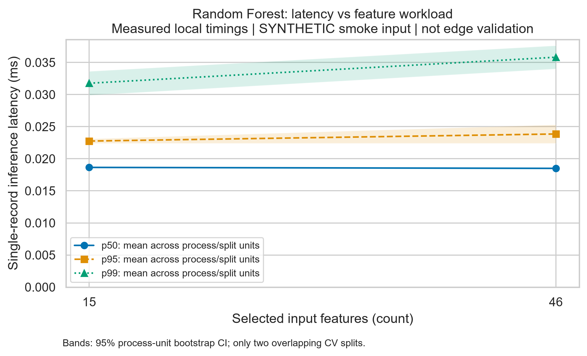
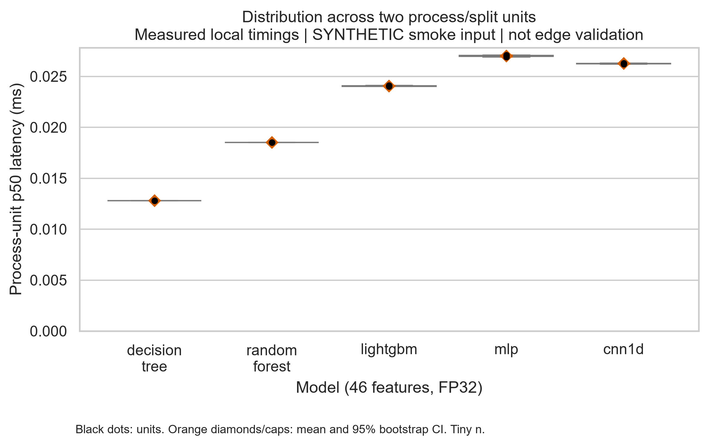

# Task 3: Lightweight IoT IDS benchmark

**Ilkhan Kuanyshev | 5 November 2026**

> MEASURED LOCAL SMOKE TIMINGS / SYNTHETIC INPUT / NO CONFIRMATORY RESULTS

## 1. Research aim and evidence status

This individual project continues the accuracy-cost trade-off study of lightweight machine-learning models for IoT intrusion detection. The full research design uses CICIoT2023, 46 features, eight categories and a constrained edge inference platform. Author: Ilkhan Kuanyshev.

This submission delivers the Task 3 analysis implementation and an executed technical demonstration. The repository contained a ten-row synthetic schema fixture, not a real CICIoT2023 sample. The fixture was augmented by the inherited smoke configuration. No real-data detection result is reported.

The latency values are actual clock measurements from ONNX inference on this local Windows computer. They are not invented latency samples. However, they describe models trained on synthetic smoke input and cannot establish operational IDS quality, Raspberry Pi performance or the project hypotheses.

Evidence classes: (1) verified execution artifacts and local timings; (2) demonstration-only quality scores on synthetic data; (3) planned, unperformed real-data and target-device experiments. H1.1, H1.2 and H1.3 are NOT TESTED.

## 2. Continuity with Task 2 and implementation

The source project is preserved, including dataset mapping, train-only mutual-information selection, five model families, ONNX export, neural INT8 quantization, train/measure separation and the original test suite. Upstream revision: 51759722daee772e40310fccc0ce72e9b03dea8c.

Task 3 adds strict raw-log ingestion, warm-up filtering, request-level IQR flags, process-unit summaries, seeded bootstrap confidence intervals, figures, an executed Jupyter notebook and a formal domain model. The measurement worker now writes phase-labelled JSONL after the timed loop. Missing guardrail values fail rather than silently passing.

The delivered smoke run uses two stratified folds, feature counts 46 and 15, five model families and FP32/INT8 variants for MLP and CNN. Random Forest uses 100 trees to match the Task 2 baseline. Each model process executes 100 warm-up and 1,000 measured single-record predictions; throughput uses batch 256. Smoke training budgets remain intentionally small.

Run: 20261105T163445Z_task3_smoke. Python 3.13.3; Windows-11-10.0.26200-SP0. ONNX Runtime 1.23.2. No CPU quota or 1 GiB memory limit was imposed. The snapshot and full package lock document this deviation from Task 2's Python 3.12 container.

## 3. Data processing and statistical estimands

The raw log contains 30,800 rows: 2,800 warm-up rows and 28,000 measured benchmark attempts. There are 0 request errors and 0 failed configuration rows. IQR flags identify 3,380 unusual benchmark durations; none are deleted.

Validation rejects invalid schemas, missing fields, duplicate identities, invalid phases, negative/non-finite timings and mixed real/synthetic provenance. SHA-256 binds the notebook to the packaged raw log. Successful-call latency and all-attempt error rate are separate; the configuration manifest covers workers that fail before emitting request logs.

Within each configuration/process unit, calculate mean, sample SD and p25/p50/p75/p95/p99 of successful latency. Across units, report the mean of each percentile and sample SD. Resample entire unit metrics 4,000 times with seed 42; use the 2.5th and 97.5th percentiles of bootstrap means for the displayed 95% interval.

Only two overlapping CV splits are present. The interval is descriptive, not a reliable population confidence statement. Training sets and synthetic ancestors overlap; request-level IID resampling would exaggerate precision. At n=1 the implementation returns no interval rather than manufacturing uncertainty.

Throughput is taken from timed batch execution, not the reciprocal of median latency. Model size uses 1,024 bytes per KiB; RAM uses 1,048,576 bytes per MiB. Windows peak working set is reported for this run; Linux uses VmHWM. Neither is model-only memory.

## 4. Results and discussion: smoke evidence only

The table contrasts the prespecified baseline (Random Forest, 46 features, FP32) with the proposed feature-reduction configuration (Random Forest, 15 features, FP32). Latency is mean +/- sample SD of process-unit p50 values. F1 is a synthetic-input demonstration score, not a real CICIoT2023 result.

The observed change in mean unit p50 from 46 to 15 features is -0.8% reduction (a negative value means an increase). This is descriptive for this run only. It neither confirms nor refutes the 30% reduction hypothesis: two synthetic-data folds on an unconstrained host are not the planned experiment.

The size and F1 columns show that the analysis can join quality and cost artifacts. A configuration passing thresholds in this smoke run is not a deployment recommendation. INT8 is genuinely exported and run, but its benefit on real data remains untested. All configuration summaries, including guardrail failures, are retained.

Scientific figure rules: explicit units, zero latency baseline, colorblind-safe palette, distinct percentile markers/line styles and confidence bands. Distribution points and error caps remain distinguishable in grayscale. Both figures are exported as vector PDF and 300-DPI PNG.

Figure 1 uses feature count as the manipulated workload. The supplied rubric filename is retained for compatibility; no request-arrival-rate experiment or latency-versus-RPS claim is made. Figure 2 shows process-unit p50 distributions and CIs at 46 features/FP32, rather than presenting repeated calls as independent folds.

| Configuration         | p50 ms, mean +/- SD   | 95% CI (ms)        |   Synthetic F1 |   Size (KiB) |
|:----------------------|:----------------------|:-------------------|---------------:|-------------:|
| Baseline RF, 46, FP32 | 0.01850 +/- 0.00000   | [0.01850, 0.01850] |              1 |        133.9 |
| Proposed RF, 15, FP32 | 0.01865 +/- 0.00007   | [0.01860, 0.01870] |              1 |        136.5 |

## 5. Formal domain model and research validity

The full formal artifact is docs/domain_model.md. It defines the dataset, eight-class labels, split indices, train-only feature selector, model family, precision, probabilities, timing quantiles, model size, RAM and non-inferiority margin. It includes LaTeX equations, a Mermaid measurement flow and a component-level STRIDE matrix.

Neural loss: L = -(1/|T|) sum over training records and classes of 1[y=c] log p(c|x). Class F1 = 2TP/(2TP+FP+FN); macro-F1 is the arithmetic mean over all eight classes. Benign FPR is the fraction of benign evaluation rows predicted as attacks. Undefined denominators remain explicit.

The constrained objective maximizes macro-F1 with p50 <= 1 ms, ONNX size <= 1,024 KiB, peak process memory <= 512 MiB, benign FPR <= 0.02 and no failed or missing splits. Missing metrics fail closed. No optimum or Pareto winner is selected from smoke data.

Task 2 specifies Friedman/Nemenyi comparisons and paired Wilcoxon tests with Holm corrections and a one-percentage-point non-inferiority margin. Those routines are retained, but hypothesis testing is disabled for synthetic smoke runs. Full-run interpretation must review dependence between repeated-CV folds and correction across the two RQ1 endpoints.

Additional validity threats: jittered samples are not independent traffic records; class capping changes prevalence; background processes perturb timings; two process units yield weak uncertainty estimates; x86 CPU limits do not emulate ARM; feature extraction and network queuing are outside the clock boundary. These limits prevent deployment claims.

## 6. Requirements, reproducibility and remaining work

Task 3 mapping: statistics and error audit -> src/process_data.py and data/processed/; scientific plots -> src/visualize.py and reports/figures/; executed notebook -> notebooks/01_data_analysis.ipynb; formal model -> docs/domain_model.md; structure and Git hygiene -> README.md and .gitignore.

SS6 is implemented through repository structure, a recorded environment, pinned dependencies, hashes and reproduction instructions. SS7 is implemented through isolated timing, warm-up phases, structured JSONL, error accounting and environment capture. SS8 is implemented through non-destructive outlier flags, percentile summaries, bootstrap uncertainty and dual-format figures.

To reproduce the saved analysis: install requirements-task3-lock.txt, run python -m src.task3, then python scripts/execute_notebook.py. To collect a new demonstration, add --collect --config configs/task3_smoke.yaml. Re-running collection changes wall-clock values; re-analysis of the saved log is seeded and deterministic.

Before scientific completion: obtain and verify real CICIoT2023 records; execute the full 5x3 design with all four feature counts; measure under the specified target limits; retain raw failures and complete split pairing; inspect leakage and dependence; replace smoke tables and figures; then review and publish the GitHub release. Repository: https://github.com/ilkhankuanyshev/lightweight-iot-ids-benchmark (release v3.0).

Source materials: Task1_Report_Kuanyshev.pdf (research aim and hypotheses); English.pdf (Task 2 protocol); ss6.docx.pdf (reproducibility); ss7.docx.pdf (clean measurement); ss8.docx (1).pdf (processing and graphics); Task 3.docx.pdf (deliverables and rubric). The attached documents are project requirements, not empirical measurement evidence. The Task 1 literature claims were not independently revalidated for this implementation.
